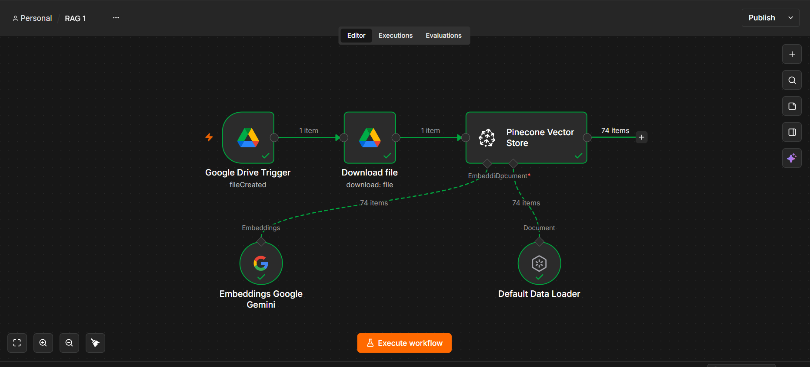
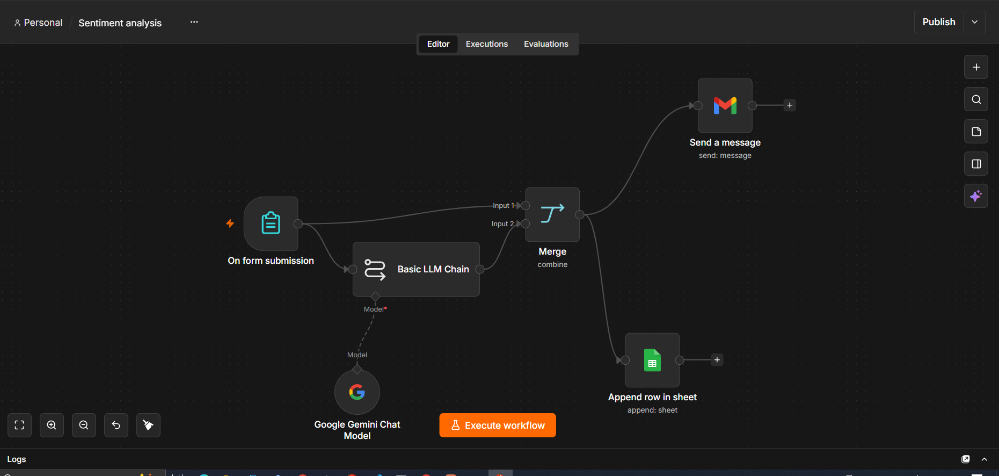
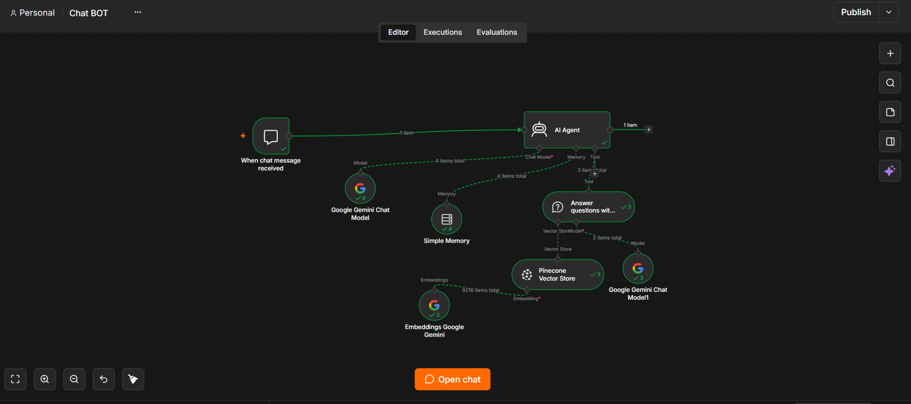
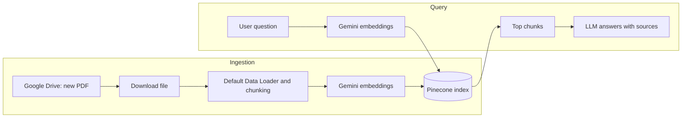

# n8n AI Automation: course projects

My hands-on workflows and notes from the Udemy course
**"AI Automation: Build LLM Apps & AI Agents with n8n & APIs"**.
Backend developer (Laravel / Django) adding AI automation, RAG and agents to the toolbox.

## Workflows

| # | Workflow | Flow | Tools |
|---|----------|------|-------|
| 01 | [Airtable form to record](workflows/01-airtable-form-to-record.json) | Form submission, create Airtable record | Form, Airtable |
| 02 | [Airtable search and export](workflows/02-airtable-search-export-file.json) | Schedule, search Airtable, convert to file, write to disk | Schedule, Airtable |
| 03 | [Google Sheets spreadsheet](workflows/03-google-sheets-create-spreadsheet.json) | Manual run, create a Google spreadsheet | Google Sheets |
| 04 | [Order notification email](workflows/04-order-notification-email.json) | New Airtable order, AI writes the summary (OpenAI or Gemini), code node parses JSON, Gmail sends it to the team | Airtable, OpenAI, Gemini, Code, Gmail |
| 05 | [Sentiment analysis](workflows/05-sentiment-analysis.json) | Form, Gemini classifies sentiment, merge, log row in Sheets, Gmail alert | Form, Gemini, Merge, Sheets, Gmail |
| 06 | [Open-source LLM agent](workflows/06-open-source-llm-ollama-agent.json) | Chat trigger, AI Agent running a local Ollama model | Chat, AI Agent, Ollama |
| 07 | [RAG ingestion](workflows/07-rag-ingestion-pinecone.json) | New PDF in Drive, download, chunk, Gemini embeddings, store in Pinecone | Drive, Gemini, Pinecone |
| 08 | [RAG chatbot](workflows/08-rag-chatbot.json) | Chat trigger, AI Agent (Gemini) with Simple Memory and a Pinecone Q&A tool; answers only from the stored reports | Chat, AI Agent, Gemini, Memory, Pinecone |

Exported JSON files live in [`workflows/`](workflows/). Personal IDs and emails are replaced with `YOUR_...` placeholders; add your own after importing.

Full descriptions: [docs/workflow-summaries.md](docs/workflow-summaries.md)

### Screenshots

**07 RAG ingestion** (one PDF became 74 chunks in Pinecone)

**05 Sentiment analysis**

**08 RAG chatbot** (AI Agent with memory and a Pinecone tool)

## RAG pipeline (workflows 07 and 08)

## Stack

n8n (self-hosted, local), Google Gemini (chat and embeddings), OpenAI, Ollama, Pinecone (vector DB),
Google Drive, Google Sheets, Airtable, Gmail.

## Run a workflow

1. In n8n: **Workflows, Import from file**, choose a JSON from `workflows/`.
2. Open each node that shows a credential warning and add **your own** credentials.
3. Create the Pinecone index first (see [`scripts/create-pinecone-index.ps1`](scripts/create-pinecone-index.ps1)).
4. Execute the workflow.

Exports contain credential names only, never secrets. Keys go in n8n credentials or a local `.env`, never in this repo.

## Notes

- [Workflow summaries](docs/workflow-summaries.md)
- [RAG and vector databases](docs/rag-and-vector-db.md)
- [Fine-tuning vs RAG](docs/fine-tuning-vs-rag.md)
- [Troubleshooting: Gemini embeddings and Pinecone](docs/troubleshooting.md)

## Roadmap

- [x] Basic automation (forms, Airtable, Google Sheets, Gmail)
- [x] LLM steps with OpenAI, Gemini and a local Ollama model
- [x] RAG ingestion from Google Drive into Pinecone
- [x] RAG chatbot: AI Agent + memory + Pinecone tool (next: sources and a strict "I don't know" rule)
- [ ] AI agent with tool calling (own Laravel/Django API as a tool)
- [ ] Lead capture, AI qualification, CRM, email follow-up
- [ ] Order/invoice processing with AI extraction
- [ ] Demo videos for each project

## Author

Md. Raisul Islam, backend developer (Laravel, Django, PostgreSQL). GitHub: [@RahatVortex98](https://github.com/RahatVortex98)
