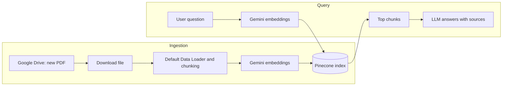

# n8n AI Automation: course projects

My hands-on workflows and notes from the Udemy course
**"AI Automation: Build LLM Apps & AI Agents with n8n & APIs"**.
Backend developer (Laravel / Django) adding AI automation, RAG and agents to the toolbox.

## Workflows

| # | Workflow | What it does | Status |
|---|----------|--------------|--------|
| 01 | Airtable + AI + Gmail | Basic automation: Airtable record, AI step, Gmail send | add JSON |
| 02 | RAG ingestion | Google Drive PDF, chunks, Gemini embeddings, Pinecone | add JSON |
| 03 | RAG chatbot | Chat agent that answers from the PDFs, with sources | planned |
| 04 | AI agent with tools | Agent that calls HTTP/DB tools (Laravel or Django API) | planned |

Exported JSON files live in [`workflows/`](workflows/). Screenshots live in [`screenshots/`](screenshots/).

## RAG pipeline (workflow 02 and 03)

## Stack

n8n (self-hosted, local), Google Gemini (chat and embeddings), Pinecone (vector DB),
Google Drive, Airtable, Gmail.

## Run a workflow

1. In n8n: **Workflows, Import from file**, choose a JSON from `workflows/`.
2. Open each node that shows a credential warning and add **your own** credentials.
3. Create the Pinecone index first (see [`scripts/create-pinecone-index.ps1`](scripts/create-pinecone-index.ps1)).
4. Execute the workflow.

Exports contain credential names only, never secrets. Keys go in n8n credentials or a local `.env`, never in this repo.

## Notes

- [RAG and vector databases](docs/rag-and-vector-db.md)
- [Fine-tuning vs RAG](docs/fine-tuning-vs-rag.md)
- [Troubleshooting: Gemini embeddings and Pinecone](docs/troubleshooting.md)

## Roadmap

- [x] Basic automation (Airtable, AI, Gmail)
- [x] RAG ingestion from Google Drive into Pinecone
- [ ] RAG chatbot with sources and an "I don't know" rule
- [ ] AI agent with tool calling (own Laravel/Django API as a tool)
- [ ] Lead capture, AI qualification, CRM, email follow-up
- [ ] Order/invoice processing with AI extraction
- [ ] Demo videos for each project

## Author

Md. Raisul Islam, backend developer (Laravel, Django, PostgreSQL). GitHub: [@RahatVortex98](https://github.com/RahatVortex98)
