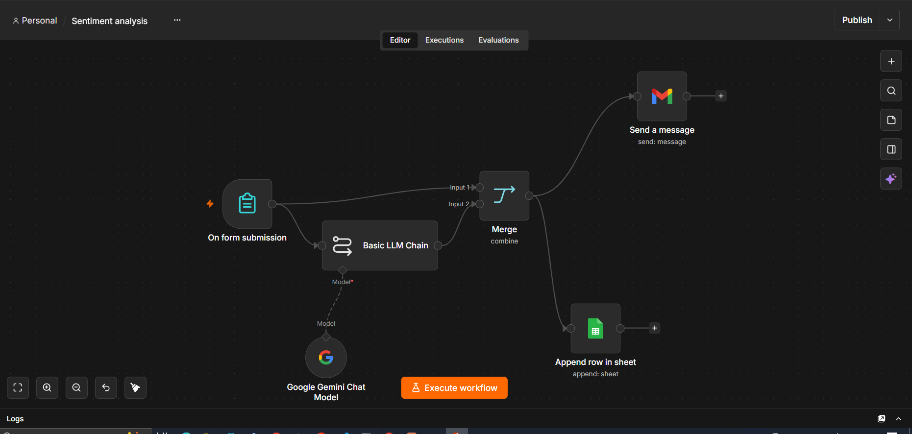
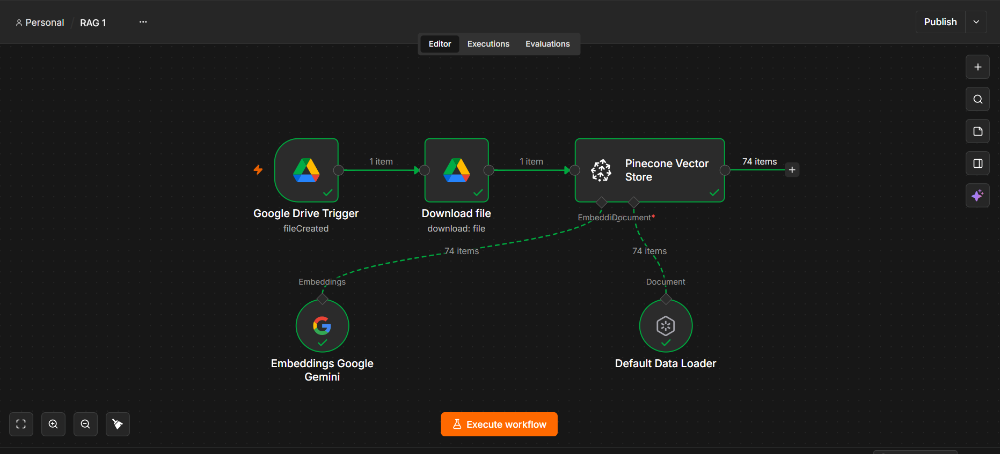
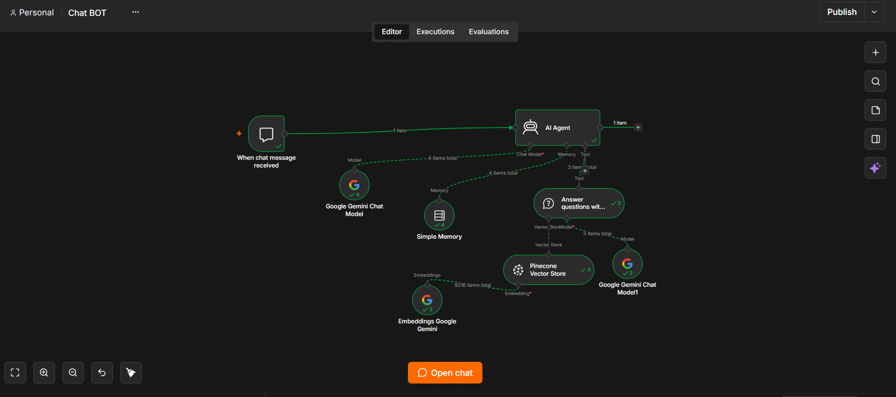

# Workflow summaries

What each exported workflow does, in the order I built them.

## 01 Airtable form to record
**Flow:** Form submission, create Airtable record.
A public form ("Which room do you like?") collects a name and a room type (single, double bed, king size).
The answers are saved as a new record in an Airtable table.
**Learned:** form trigger, field mapping into Airtable, Airtable token credential.

## 02 Airtable search and export
**Flow:** Schedule (every minute), search Airtable, convert to file, write to disk.
Reads the `Room` field from Airtable records, turns it into a text file and writes it to a local folder.
**Learned:** schedule trigger, search operation, binary files and the Read/Write Files node.

## 03 Google Sheets spreadsheet
**Flow:** Manual run, create a spreadsheet.
Creates a new Google spreadsheet from n8n.
**Learned:** Google OAuth credentials, Google Sheets node basics.

## 04 Order notification email
**Flow:** Airtable trigger, Gemini writes the email, Code node parses it, Gmail sends it.
Checks Airtable every minute for new orders. Gemini turns the order details into a clear summary email
signed "Customer Success Team" and returns a subject and body. A Code node extracts `email_subject` and
`email_content` from the model output (with a fallback parser), and Gmail sends it to the team.
An OpenAI node is also on the canvas but not connected, since I used the free Gemini API.
**Learned:** polling trigger, prompting for structured output, JavaScript Code node, Gmail node.

## 05 Sentiment analysis
**Flow:** Form, Gemini classifies, merge, log to Sheets and email.
A review form takes a name and a review. A Basic LLM Chain (Gemini) answers with one word:
Positive, Negative or Neutral. Merge combines the form data with the AI answer by position, then the result
is appended as a row in Google Sheets and sent as an HTML table by Gmail.
**Learned:** Basic LLM Chain, system prompt for one-word output, Merge node, branching one output to two nodes.



## 06 Open-source LLM agent
**Flow:** Chat trigger, AI Agent, Ollama chat model.
A chat window backed by an AI Agent that runs a local open-source model through Ollama.
No API key or paid subscription needed.
**Learned:** AI Agent node, chat model sub-node, running models locally.

## 07 RAG ingestion
**Flow:** Drive trigger, download file, data loader, Gemini embeddings, Pinecone.
Watches a Google Drive folder for new files. A new PDF is downloaded, the Default Data Loader (PDF loader)
turns it into chunks, Gemini creates embeddings, and the Pinecone Vector Store node inserts them into the
`n8n-rag-v2` index (namespace `n8n-rag`). In my test run, one PDF produced 74 items (chunks).
**Learned:** RAG ingestion, embeddings, vector databases, matching index dimension to the embedding model
(see [troubleshooting](troubleshooting.md)).



## 08 RAG chatbot
**Flow:** Chat trigger, AI Agent. The agent has a Gemini chat model, Simple Memory and one tool.
The tool, "Answer questions with a vector store", combines the Pinecone Vector Store
(index `n8n-rag-v2`, Gemini embeddings) with its own Gemini chat model.

How a question is answered:
1. The Chat trigger passes the message to the AI Agent.
2. The agent reads its prompt and the memory (recent messages) and decides whether it needs the documents.
3. It calls the Q&A tool, which embeds the question, finds the closest chunks in Pinecone, and a Gemini model writes an answer from them.
4. The agent replies, and Simple Memory saves the exchange.

In my test run the tool was called 3 times and the embeddings node produced 9216 values (3 searches at 3072 dimensions).

**Agent prompt as exported:** answer from the Q3 and Q4 reports only, concise, with numbers, and name the quarter each fact comes from.

**Stricter version I plan to use (cleaned up, with "always call the tool"):**
```
You are an AI assistant specialized in analyzing Tesla's quarterly financial reports.
Answer questions accurately and precisely using the vector database, which contains the uploaded reports.

ALWAYS call the vector store tool before answering. Only provide information you retrieve from the documents.
If the information is not in the documents or is unclear, say: "I don't have this information in the uploaded reports."
Never answer from your own knowledge.

Response format:
- Concise and to the point
- Specific numbers and facts when available
- Say which quarterly report each fact comes from
```

**Learned:** AI Agent vs fixed workflow, tools, memory vs vector store, chunks and embeddings, handling Gemini 503 errors
with Retry On Fail and a stable model (see [troubleshooting](troubleshooting.md)).



**Settings in the export:** both Gemini chat models are `gemini-3.5-flash-lite`, Simple Memory keeps the last 10 messages,
and the Pinecone node uses index `n8n-rag-v2` with no namespace set.

**Check:** the ingestion workflow (07) writes to namespace `n8n-rag`, but the chatbot's Pinecone node has no namespace.
The namespace must be the same in both workflows, or the chatbot searches an empty namespace and finds nothing.

Workflow file: [`workflows/08-rag-chatbot.json`](../workflows/08-rag-chatbot.json)
